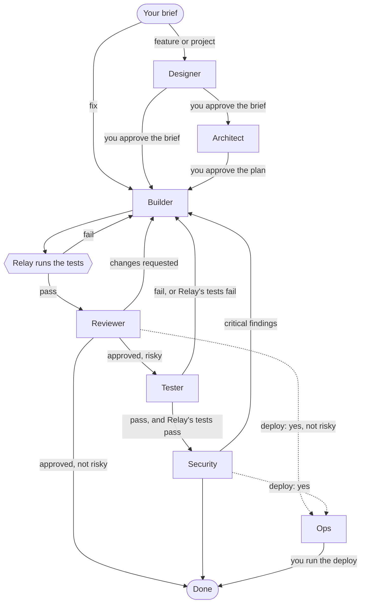

# Relay

[](https://github.com/netdevjamie/relay/actions/workflows/test.yml)
[](LICENSE)
[](https://www.python.org/downloads/)

Relay runs a piece of software work through a short chain of Claude Code roles, each with one job: Designer, Architect, Builder, Reviewer, Tester, Security and Ops. It records every step in a SQLite ledger, runs your tests itself instead of taking a role's word for it, and stops for you at the decisions that are yours to make. You can make those decisions from your phone.

The roles do the work. Relay's code keeps the rules. You decide what matters.

## How a task runs



The diagram leaves out the other stops: a pass with warnings or concerns, Security's findings, a role that asks for you, and the limits on fix rounds and retries.

- **The brief sizes the chain.** A short header in the brief gives `size`, `risky` and `deploy`. A `fix` goes straight to the Builder. A `feature` starts with the Designer and calls the Architect only when the structure changes. A `project` always gets both. `risky: yes` (auth, input handling, money, production data) adds the Tester and Security. A brief Relay can't read gets the full chain.
- **Relay runs the tests.** After each Builder step and each Tester pass, Relay runs the project's test command in the task's checkout, at its commit, and records the result in the ledger. It refuses a checkout with uncommitted changes. A failing run goes back to the Builder.
- **Every step is a file.** Each role writes a numbered Markdown report that starts with its verdict. Relay routes on that verdict from a fixed table ([`orchestrator/routing.py`](orchestrator/routing.py)), not on a reading of the prose.
- **You decide at the gates.** Relay stops for you after the Designer, after the Architect's plan, on any verdict that passed with warnings, and before anything deploys. It also stops whenever a role asks for you or Relay can't tell what to do next. You approve, send it back with a note, move it to another phase, or abort. Notes go to every later role.
- **Fix rounds are capped.** If a review still finds a high-rated problem after two fix rounds, Relay stops and asks you instead of looping.
- **Nothing ships on its own.** Ops prepares the deploy, the smoke test and the rollback. You run the deploy.

## A real run

[`examples/recorded-run-add-max-length/`](examples/recorded-run-add-max-length/) is one task run on the sample app in [`examples/slugify/`](examples/slugify/), saved as Relay left it. The Reviewer approved with a warning, the owner sent it back from the gate card, and one fix round closed it. Here's how `relay status` summed it up:

```text
$ relay status add-max-length
Task: add-max-length
  Status: completed
  Phase: done

  History:
    01 designer -> ready-for-builder
    02 builder -> ready-for-review
    03 reviewer -> approved_with_warnings
    04 builder -> ready-for-review
    05 reviewer -> approved

  The owner's notes:
    (note, at designer): Keep whole words, with no limit on how far the cut
      moves back. Add one README example. Use argparse for the command line.
    (sent_back, at reviewer): Fix the medium: a title that starts with a
      hyphen must still print a slug, as it did before. Fix both lows too.

  Test runs (Relay's own):
    after step 2 (builder): Tests passed at ded286d8f152 in 0.6s: 49 tests, 0 failed, 0 skipped.
    after step 4 (builder): Tests passed at 8411999eb22f in 0.7s: 69 tests, 0 failed, 0 skipped.
```

Timestamps and a few lines are trimmed, and the notes are wrapped to fit the page. The [examples README](examples/README.md) walks through each file.

## Quick start

You need macOS or Linux, Python 3.11 or newer, git, and [Claude Code](https://code.claude.com/docs/en/overview). The sample app's tests use Python's own `unittest`, so nothing else needs installing.

```bash
# 1. Install. Puts Relay in ~/Projects/.relay, the role prompts in
#    ~/.claude/agents, and the relay command in ~/.local/bin.
git clone https://github.com/netdevjamie/relay.git
cd relay
./setup.sh
# If relay is not found: export PATH="$HOME/.local/bin:$PATH"
relay doctor

# 2. Make a copy of the sample app and register it.
cp -R examples/slugify ~/slugify
cd ~/slugify && git init -q && git add -A && git commit -qm "Sample app"
relay register ~/slugify --alias slugify

# 3. Give Relay the sample brief and start the task on a branch of its own.
mkdir -p ~/Projects/.relay/tasks/add-max-length
cp ~/relay/examples/briefs/add-max-length.md ~/Projects/.relay/tasks/add-max-length/brief.md
git switch -c add-max-length
relay start add-max-length --repo slugify
```

Adjust `~/relay` to wherever you cloned the repo.

`relay start` records the checkout you run it from and prints the prompt for the first role, which starts by asking for that role by name ("Use the Designer subagent: ..."). Paste it into a Claude Code session in the same folder. When the role has written its report, run `relay next add-max-length`. Relay reads the verdict, runs the tests when a Builder step has finished, and either prints the next role's prompt or stops for you with a gate card. Repeat until the task is done.

`relay next --auto` starts each role for you as a headless Claude Code session instead. A headless role can't ask for permissions, so give the project an allow-list in `.claude/settings.local.json` first.

### Your own task

1. Add `.relay/profile.yaml` to your repo so Relay knows how to run its tests (`relay profile <alias>` checks it; [`docs/profile.md`](docs/profile.md) lists the fields), and register the repo with `relay register`.
2. Copy `~/Projects/.relay/templates/task-brief.md` to `~/Projects/.relay/tasks/<task-id>/brief.md` and fill it in. The header at its top sets `size`, `risky` and `deploy`; the folder name is the task id.
3. Make a branch for the task in your repo, and run `relay start <task-id> --repo <alias>` from it.

## From your phone

Every gate fits on a phone screen. When Relay stops for you, it prints a card like this one (cut down from the real run):

```text
add-max-length
Step 3, Reviewer

Reviewer gate
Reviewer's summary: The length cap works and is well tested. One
thing to decide: with argparse, titles that start with a hyphen
(like "-x") now fail on the command line.
Medium (1)
Low (2)

Choices:
1. accept-close   Accept the findings and close the task.
2. send-back      Send back to Builder for another round.
3. move-to        Move to a phase you name (--to) by override.
4. abort          Abort the task.
5. note           Add a note for every later agent. Moves nothing.

relay decide add-max-length <choice> --step 3 --gate approval
```

| Command | What it does |
| --- | --- |
| `relay waiting` | Lists every task waiting on you, with why it stopped |
| `relay card <task>` | Prints that task's gate: the report's summary, its findings, and each choice in words |
| `relay show <task> <report>` | Prints one report, or the brief, in full |
| `relay decide <task> <choice> --step N --gate KIND` | Makes the choice, but only if the task still waits at that step and gate |

To use these away from your desk, turn on [Remote Control](https://code.claude.com/docs/en/remote-control) for the Claude Code session that drives Relay, and turn on push notifications in `/config`. The phone talks to that session, and your computer opens no port. `relay decide` runs the same commands you'd type at the keyboard, so the ledger records the same events either way.

## Prototypes

When the question is "is this worth building at all?", sketch it first instead of running the chain:

```bash
relay proto start checkin --repo my-app --idea "What it is, who it's for, what wow looks like." --hours 4
# build on the proto/checkin branch, save screenshots in the evidence folder
relay proto done checkin
relay promote checkin --size feature --risky no
```

Relay records a time box of at most 8 hours, prints the `proto/` branch to build on, and tells the session to use demo data only and never touch production; nothing enforces those last two. Its code is never merged: `relay start` refuses a `proto/` branch. `relay promote` writes the brief for the real task and attaches the prototype's screenshots as its spec.

## The roles

Each role is a short prompt in [`agents/`](agents/) with a fixed list of verdicts.

| Role | Job | Verdicts |
| --- | --- | --- |
| [Designer](agents/designer.md) | Turns your request into a brief: what to build and why | `ready-for-builder`, `ready-for-architect`, `needs-human-input`, `recommend-no-build` |
| [Architect](agents/architect.md) | Writes a file-level plan. Writes no code | `ready-for-builder`, `needs-designer`, `needs-human-input` |
| [Builder](agents/builder.md) | Writes the code and tests that fail without the change | `ready-for-review`, `needs-architect`, `blocked` |
| [Reviewer](agents/reviewer.md) | Reviews the change against the brief and the plan | `approved`, `approved_with_warnings`, `changes_requested`, `blocked` |
| [Tester](agents/tester.md) | Tries to break the change and records the exact commands | `pass`, `pass_with_concerns`, `fail` |
| [Security](agents/security.md) | Attacks the change in a local or test environment | `secure`, `findings`, `critical-findings` |
| [Ops](agents/ops.md) | Checks the change is safe to ship and writes the deploy, smoke test and rollback | `deploy-ready`, `not-ready`, `needs-manual-steps` |

## What Relay is not

- **Not autopilot.** It stops for you on purpose, and nothing deploys unless you run it.
- **Not a sandbox.** Roles run in Claude Code with whatever permissions you give them. Relay checks their output, not their actions. The Ops role is kept from deploying by its prompt alone.
- **Not a general agent framework.** The roles and the routing are fixed. You can edit the prompts, but the shape of the chain is the point.
- **Not finished.** It's a single-owner tool that runs on one computer. [`docs/known-limits.md`](docs/known-limits.md) lists what it doesn't do yet.

## Documentation

- [`context/PROJECT.md`](context/PROJECT.md): the principles and the rules every role follows
- [`context/DECISIONS.md`](context/DECISIONS.md): the design decisions and the reasons for them
- [`docs/profile.md`](docs/profile.md): telling Relay how to run a project's tests
- [`docs/json-api.md`](docs/json-api.md): the JSON read API (`relay list --json`, `relay status --json`)
- [`DEPLOYMENT.md`](DEPLOYMENT.md): install, upgrade and rollback

## Development

```bash
python3 -m venv .venv
.venv/bin/pip install -r orchestrator/requirements.txt pytest
.venv/bin/pytest -q orchestrator/tests tools/tests
```

The suite needs Python 3.11 or newer; if `python3 --version` says older, use a newer one for the venv (`python3.12 -m venv .venv`). CI runs the suite on Python 3.11 and 3.12.

## License

MIT. See [LICENSE](LICENSE).
