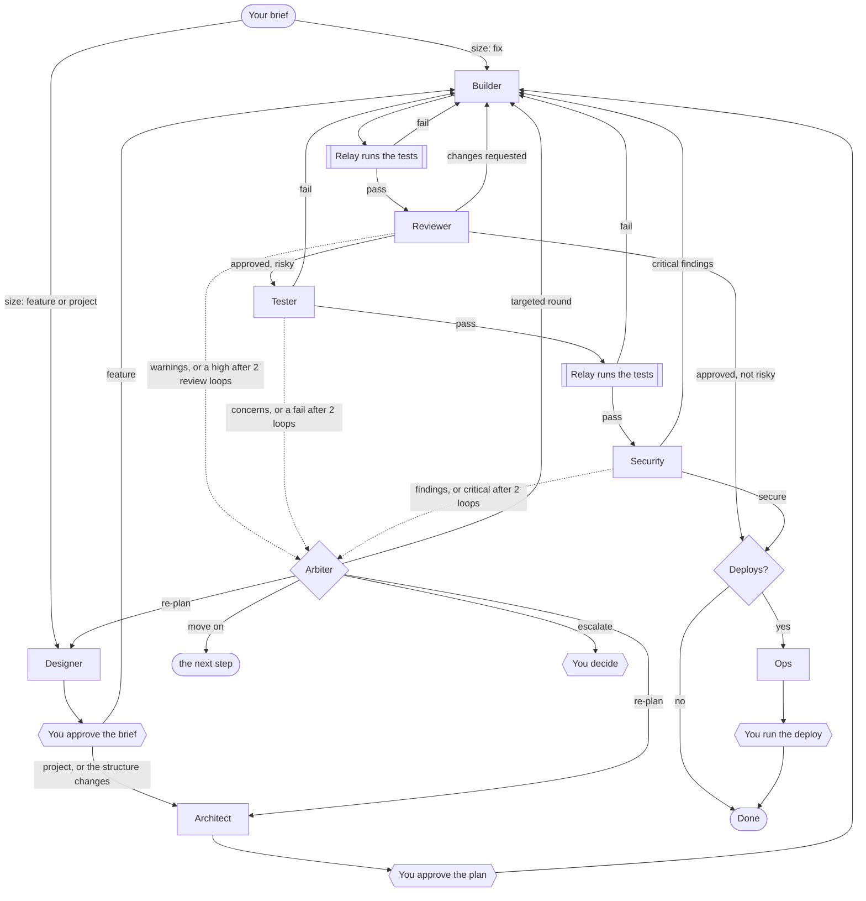

<p align="center">
  <picture>
    <source media="(prefers-color-scheme: dark)" srcset="docs/brand/relay-lockup-dark.svg">
    <source media="(prefers-color-scheme: light)" srcset="docs/brand/relay-lockup-light.svg">
    
  </picture>
</p>

# Relay

[](https://github.com/netdevjamie/relay/actions/workflows/test.yml)
[](LICENSE)
[](https://www.python.org/downloads/)

Relay runs a piece of software work through a short chain of Claude Code roles, each with one job: Designer, Architect, Builder, Reviewer, Tester, Security and Ops, with an Arbiter that decides when a review loop has gone on long enough. It records every step, runs your tests itself instead of taking a role's word for it, and stops for you at the decisions that are yours to make. You can make those decisions from your phone.

**The other tools tell the agent to be careful. Relay checks.**

The roles do the work. Relay's code keeps the rules. You decide what matters.

## How a task runs



Hexagons are your gates. The diagram leaves out the rarer stops: a role that asks for you, a verdict Relay can't read, the limit on rounds nobody chose, a role that runs past its time limit, and the backstops on the Arbiter below.

- **The brief sizes the chain.** A short header in the brief gives `size`, `risky` and `deploy`. A `fix` goes straight to the Builder and ends at the Reviewer. A `feature` starts with the Designer and calls the Architect only when the structure changes. A `project` always gets both. `risky: yes` (auth, input handling, money, production data) adds the Tester and Security. `deploy: yes` adds Ops. A brief Relay can't read gets the full chain.
- **The sizing can grow.** After each Builder round Relay lists which risk categories the changed paths look like they touch: a hint from file names, never a rule. The Reviewer judges the diff against the sizing and may raise it, which takes effect at once; on a `risky: no` task whose hint matched, it must answer raise or keep, with a reason. The Arbiter may raise it too. Only you lower a sizing, with `relay resize`.
- **Relay runs the tests.** After each Builder step and each Tester pass, Relay runs the project's test command in the task's checkout, at its commit, and records the result. It refuses a checkout with uncommitted changes. A failing run goes back to the Builder whatever the role said. A passing run stops for you when the branch changed the test command or a file the tests run on (the harness), or when fewer tests ran than before. When the branch added or changed tests, Relay also runs them over the base's code and records which of them failed there ("seen to fail"), so a test that could never fail shows up on the gate.
- **The Arbiter decides the warnings and the long loops.** A Reviewer, Tester or Security pass with warnings, and a high-rated finding after two review loops on the same plan, go to the Arbiter: a read-only role that reads the whole loop with fresh eyes and rules move on, a targeted round, a re-plan, or escalate to you. Relay acts only on the ruling in its report's header, and code fences it: a move on stops for you while Security has reported a high since the latest build or Relay's latest test run did not pass, and before it would close the task or reach Ops; a second re-plan stops for you; a ruling Relay can't act on exactly stops and moves nothing.
- **Every step is a file.** Each role writes a numbered Markdown report that starts with its verdict. Relay routes on that verdict from a fixed table ([`orchestrator/routing.py`](orchestrator/routing.py)), not on a reading of the prose.
- **You decide at the gates.** Relay stops for you after the Designer's brief, after the Architect's plan, when the Arbiter escalates, and before anything deploys. You approve, send it back with a note, move it to another phase, or abort. Notes go to every later role.
- **Nothing ships on its own.** Ops prepares the deploy, the smoke test and the rollback. You run the deploy.

## Quick start

You need macOS or Linux, Python 3.11 or newer, git, and [Claude Code](https://code.claude.com/docs/en/overview). The sample app's tests use Python's own `unittest`, so nothing else needs installing.

```bash
# 1. Install. Puts Relay and its SQLite ledger in ~/Projects/.relay, the
#    role prompts in ~/.claude/agents, and the relay command in ~/.local/bin.
git clone https://github.com/netdevjamie/relay.git
cd relay
./setup.sh
# If relay is not found: export PATH="$HOME/.local/bin:$PATH"
relay doctor

# 2. Make a copy of the sample app and register it.
cp -R examples/slugify ~/slugify
cd ~/slugify
git init -q
relay register ~/slugify --alias slugify
git add -A && git commit -qm "Sample app"
relay profile slugify

# 3. Give Relay the sample brief and start the task on a branch of its own.
mkdir -p ~/Projects/.relay/tasks/add-max-length
cp ~/relay/examples/briefs/add-max-length.md ~/Projects/.relay/tasks/add-max-length/brief.md
git switch -c add-max-length
relay start add-max-length --repo slugify
```

Adjust `~/relay` to wherever you cloned the repo. `relay register` writes a one-line `.relay.yaml` into the repo, which is why the commit comes after it: Relay refuses to test a checkout with uncommitted files. `relay doctor` checks Python, git, the `claude` command, the role prompts, the write-guard hook, the registry and the ledger, and says how to fix what it finds; until the sample is registered it warns that no repos are registered.

`relay start` records the checkout you run it from and prints the prompt for the first role, the Designer. On a Mac it also keeps the machine awake for up to two hours while the role runs.

**What happens next, by hand.** Paste the prompt into a Claude Code session in the same folder; it starts with `@designer`, which asks for the role by name. When the role has written its report, run `relay next add-max-length`. Relay reads the verdict, runs the tests when a Builder or Tester has finished, and either prints the next role's prompt or stops for you with a gate card. Repeat until the task is done. Run `relay next` before the report exists and it says it found no verdict, exits 1 and changes nothing.

**What happens next, with `--auto`.** `relay next add-max-length --auto` starts each role itself as a headless Claude Code session (`claude --agent <Role> --print`), in bypass permission mode, with a two-hour time limit per role, and goes on until it reaches a gate. See "Running roles automatically" below before you use it.

### Your own task

1. Add `.relay/profile.yaml` to your repo so Relay knows how to run its tests (`relay profile <alias>` checks it; [`docs/profile.md`](docs/profile.md) lists the fields), register the repo with `relay register`, and commit both files.
2. Copy `~/Projects/.relay/templates/task-brief.md` to `~/Projects/.relay/tasks/<task-id>/brief.md` and fill it in. The header at its top sets `size`, `risky` and `deploy`; the folder name is the task id.
3. Make a branch for the task in your repo, and run `relay start <task-id> --repo <alias>` from it.

## A sample run

The quick start above, run as written from a fresh clone with a throwaway home folder. The prompt is cut where it says `...`, and lines that only print folder paths are left out.

```text
$ relay profile slugify
...
  Valid. Test command: python3 -m unittest -q
  Deploy targets: none

$ relay start add-max-length --repo slugify
Task add-max-length started.
  Phase: designer
  Size: feature; risky: no
  Artifact: 01-designer.md
  Deploy intent: False
...
  Branch:   add-max-length (base main at 4c5ec5b)
  Keeping this Mac awake for up to 120 minutes while designer runs (a closed lid still sleeps it).

  Run this in Claude Code:

    @designer You are executing phase 'designer' for task 'add-max-length'.

Follow your agent definition exactly.
...
IMPORTANT: Your artifact MUST begin with YAML frontmatter in this exact format:
---
task_id: add-max-length
phase: designer
step: 1
date: 2026-11-21
verdict: <your verdict>
---
...
  Then run: relay next add-max-length

$ relay next add-max-length
Warning: No verdict found in 01-designer.md
  The artifact may be missing YAML frontmatter.
  Current phase: designer
  Expected one of: ready-for-architect, ready-for-builder, needs-human-input, recommend-no-build

  Options:
    1. Fix the artifact and run 'next' again
    2. Use 'override add-max-length <phase>' to manually advance

$ relay status add-max-length
Task: add-max-length
  Status: in_progress
  Phase: designer
  Deploy intent: False
  Sizing:
    Size: feature; risky: no
    risk hint: none recorded yet
  Created: 2026-11-21T13:10:37Z
  Updated: 2026-11-21T13:10:37Z

  History:
    01 designer (2026-11-21T13:10:37Z)

$ relay waiting
Nothing is waiting on you.
```

That is as far as Relay goes without a role: the Designer's report is what `relay next` waits for. Once it is written, `relay next` stops at your first gate, the brief, with a gate card (see "From your phone").

## What a run costs

No figure has been measured yet, so this section gives none. What drives the cost of a task, in tokens and time:

- **How many roles run.** The sizing decides it: a `fix` runs the Builder and the Reviewer; a `feature` adds the Designer, and the Architect when the structure changes; `risky: yes` adds the Tester and Security; `deploy: yes` adds Ops. A raise mid-run adds roles.
- **How many rounds.** Each send-back or high-rated finding is another Builder step and another review. Each warning verdict and each long loop is an Arbiter step.
- **What each role reads.** Every role reads the brief and the latest report of each role that has run; the Arbiter reads the whole loop. Long reports make every later step cost more.
- **Model and effort.** Under `--auto`, `model` and `effort` in Relay's config (per role under `roles:`) choose them; by hand, the session you paste into does.

Relay's own test runs cost no tokens: they run your test command on your machine.

## How it compares

By kind of tool, not by product:

- **An autonomous coding agent** takes a task and works it through to a result in its own loop. Relay splits the same work across fixed roles, and puts its own checks (the test runs, the harness check, seen to fail) and your decisions between them.
- **An agent framework** gives you the parts to build your own graph of agents. Relay is one graph, already built, with its routing in code and its roles in short prompts you can read.
- **Subagents in one Claude Code session** hand work to each other inside that session. Relay keeps the state outside any session, in report files and a SQLite ledger, so any step can be read, rerun, sent back or decided from your phone later.

Relay runs on top of Claude Code. It is a fit when you want a record and a second look at every step. For a one-line change you could make yourself, it is more ceremony than you need.

## The roles

Each role is a short prompt in [`agents/`](agents/) with a fixed list of verdicts.

| Role | Job | Verdicts |
| --- | --- | --- |
| [Designer](agents/designer.md) | Turns your request into a brief: what to build and why | `ready-for-builder`, `ready-for-architect`, `needs-human-input`, `recommend-no-build` |
| [Architect](agents/architect.md) | Writes a file-level plan. Writes no code | `ready-for-builder`, `needs-designer`, `needs-human-input` |
| [Builder](agents/builder.md) | Writes the code and tests that fail without the change | `ready-for-review`, `needs-architect`, `blocked` |
| [Reviewer](agents/reviewer.md) | Reviews the change against the brief and the plan; judges the sizing | `approved`, `approved_with_warnings`, `changes_requested`, `blocked` |
| [Tester](agents/tester.md) | Tries to break the change and records the exact commands | `pass`, `pass_with_concerns`, `fail` |
| [Security](agents/security.md) | Attacks the change in a local or test environment | `secure`, `findings`, `critical-findings` |
| [Ops](agents/ops.md) | Checks the change is safe to ship and writes the deploy, smoke test and rollback | `deploy-ready`, `not-ready`, `needs-manual-steps` |
| [Arbiter](agents/arbiter.md) | Reads a warning verdict or a long loop and rules what happens next. Read-only | `move-on`, `targeted-round`, `re-plan`, `escalate` |

A legacy `pentest` phase still loads from old tasks; nothing routes into it.

## Running roles automatically

With `--auto`, Relay starts each role itself with `claude --agent <Role> --print <prompt>`. What each role runs with is Relay's own config, `orchestrator/config.yaml` in the install (every setting is shown in [`orchestrator/config.example.yaml`](orchestrator/config.example.yaml)). A repo's profile cannot set any of it, so a task's branch cannot change how its own roles run.

- **Permission mode.** Every role's call says `--permission-mode bypassPermissions`, because a permission prompt under `--print` cannot be answered from anywhere. The roles that only write reports (Designer, Architect, Reviewer, Security, Ops, Arbiter) keep Bash, to run tests and git; the hook in their role files fences only Write, so under bypass only the role files' words keep them read-only through the shell. Change one role's mode under `roles:`, for example `roles: {ops: {permission_mode: dontAsk}}`; a mode Claude Code does not accept is warned about and the default is used.
- **Time limit.** A role still running after `agent_timeout_seconds` (7200, two hours; per role, `roles.<role>.timeout_seconds`) is stopped with every process in its group. The task stops for you with the choices start it again, move it to a phase, or abort. Nothing the stopped role left is routed on.
- **Model and effort.** `model:` and `effort:` apply to every role; `roles.<role>.model` and `roles.<role>.effort` override them for one role. Unset means Claude Code's own default.

Without `--auto`, Relay prints the prompt and you run the role in a session of your own, with that session's permissions, model and effort, and no time limit.

## From your phone

Every gate fits on a phone screen. When Relay stops for you, `relay card <task>` prints the gate: the report's summary line, its findings by rating, what you are asked, and each choice by name with what it does.

| Command | What it does |
| --- | --- |
| `relay waiting` | Lists every task waiting on you, with why it stopped |
| `relay card <task>` | Prints that task's gate: the report's summary, its findings, and each choice in words |
| `relay show <task> <report>` | Prints one report, or the brief, in full |
| `relay decide <task> <choice> --step N --gate KIND` | Makes the choice, but only if the task still waits at that step and gate |

To use these away from your desk, turn on [Remote Control](https://code.claude.com/docs/en/remote-control) for the Claude Code session that drives Relay, and turn on push notifications in `/config`. The phone talks to that session, and your computer opens no port; nothing reaches the phone while the computer sleeps. `relay decide` runs the same commands you'd type at the keyboard, so the ledger records the same events either way, and two decides on one gate at the same moment cannot both apply.

## Prototypes

When the question is "is this worth building at all?", sketch it first instead of running the chain:

```bash
relay proto start checkin --repo my-app --idea "What it is, who it's for, what wow looks like." --hours 4
# build on the proto/checkin branch, save screenshots in the evidence folder
relay proto done checkin
relay promote checkin --size feature --risky no
```

Relay records a time box of at most 8 hours, prints the `proto/` branch to build on, and tells the session to use demo data only and never touch production; nothing enforces those last two. Its code is never merged: `relay start` refuses a `proto/` branch. `relay promote` writes the brief for the real task and attaches the prototype's screenshots as its spec.

## What Relay is not

- **Not autopilot.** It stops for you on purpose, and nothing deploys unless you run it.
- **Not a sandbox.** Roles run in Claude Code with the permissions they are given. Relay checks their output, not their actions.
- **Not a general agent framework.** The roles and the routing are fixed. You can edit the prompts, but the shape of the chain is the point.
- **Not finished.** It's a single-owner tool that runs on one computer. The honest limits, what it does not do yet and what is known wrong, are in [`docs/known-limits.md`](docs/known-limits.md).

## Documentation

- [`docs/commands.md`](docs/commands.md): every `relay` command, with an example
- [`docs/profile.md`](docs/profile.md): telling Relay how to run a project's tests, and how its test runs are checked
- [`docs/json-api.md`](docs/json-api.md): the JSON read API (`relay list --json`, `relay status --json`, `relay gate-check --json`)
- [`docs/known-limits.md`](docs/known-limits.md): the honest limits
- [`DEPLOYMENT.md`](DEPLOYMENT.md): install, upgrade and rollback
- [`CONTRIBUTING.md`](CONTRIBUTING.md): setting up, the code layout, and what a good change looks like
- [`CHANGELOG.md`](CHANGELOG.md): what changed in each release
- [`SECURITY.md`](SECURITY.md): reporting a vulnerability
- [`examples/`](examples/): the sample app and its brief

## Development

```bash
python3 -m venv .venv
.venv/bin/pip install -r orchestrator/requirements.txt pytest
.venv/bin/pytest -q orchestrator/tests tools/tests
```

The suite needs Python 3.11 or newer; if `python3 --version` says older, use a newer one for the venv (`python3.12 -m venv .venv`). The workflow in [`.github/workflows/test.yml`](.github/workflows/test.yml) runs the suite on Python 3.11 and 3.12.

## License

MIT. See [LICENSE](LICENSE).
